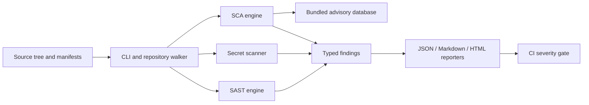

[](https://www.python.org/)
[](#capabilities)
[](#architecture)
[](#quickstart)
[](./LICENSE)
[](#docker)

# DevSecOps Scanner

A local-first Python CLI for detecting common insecure coding patterns, committed
secrets, and known vulnerable pinned Python dependencies. It emits JSON,
Markdown, or a self-contained interactive HTML executive report and can fail
CI when a configured severity threshold is met.

> The included SCA advisory file is a small, offline demonstration database, not
> a complete or continuously updated vulnerability feed. Verify production
> dependency risk with a maintained advisory service as part of your security
> program.

## Capabilities

| Engine | Checks |
|---|---|
| SAST | Python hardcoded credential assignments, `eval`/`exec`, shell execution and `shell=True`, interpolated SQL passed to `execute`, and common disabled TLS-verification patterns |
| Secrets | AWS access-key, GitHub-token, Slack-token, and private-key patterns; high-entropy values assigned to secret-like names. Secret values are not included in findings. |
| SCA | PEP 621 and Poetry dependency declarations in `pyproject.toml`, plus `requirements.txt`; checks exact pinned versions against the bundled advisory database. |
| Reports | Severity counts and risk score in JSON, Markdown, and interactive HTML. HTML supports severity and text filtering. |

The SAST rules are intentionally heuristic and currently analyze Python source;
they do not replace a language-aware commercial/static analysis platform.
Dependency checks only identify exact affected versions included in the local
database. Unpinned/ranged declarations and dependencies in other ecosystems
cannot be reliably resolved by this version.

## Architecture



```text
devsecops_scanner/
  cli.py                 Click command and severity gate
  scanner.py             File traversal and engine orchestration
  models.py              Shared severity and finding types
  sast/scanner.py        Python AST checks
  secrets/scanner.py     Token patterns and Shannon entropy
  sca/scanner.py         requirements.txt / pyproject.toml parsing
  sca/advisories.json    Offline advisory data
  reporter/report.py     JSON, Markdown, and HTML output
tests/
  fixtures/              Intentionally vulnerable scanner examples
```

## Quickstart

Requires Python 3.11 or newer.

```shell
python -m venv .venv
# Windows PowerShell: .\.venv\Scripts\Activate.ps1
# macOS/Linux:        source .venv/bin/activate
python -m pip install -e ".[dev]"
```

Scan the current directory and produce the default HTML report:

```shell
devsecops-scanner scan --path . --output report.html --fail-on high
```

The command exits with status 1 if any finding meets or exceeds `--fail-on`.
Without a threshold, a scan with findings still exits successfully, allowing
reports to be generated without blocking local development.
The report risk score is the sum of per-finding weights (Critical 10, High 7,
Medium 4, Low 1), capped at 100; it is a prioritization aid, not a probability
of compromise.

```shell
# JSON output; fail on any finding (low or higher)
devsecops-scanner scan --path src --output artifacts/security.json --fail-on low

# Markdown output and additional exclusions (relative glob patterns)
devsecops-scanner scan --path . --output report.md --exclude "tests/**" --exclude "vendor/**"

# Module invocation works without installing the console script
python -m devsecops_scanner scan --path . --output report.html
```

Built-in exclusions cover VCS metadata and common virtual-environment/build
directories. `--exclude` can be repeated. Supported output extensions are
`.html`, `.htm`, `.json`, `.md`, and `.markdown`.
Text files larger than 1 MB are skipped with a warning; invalid Python syntax
is also reported as a warning and that file is skipped by SAST.

The scanner does not upload source code or detected secrets. Reports include
file paths, line numbers, rule identifiers, descriptions, and recommendations;
secret material is deliberately redacted.

## CI/CD integration

The repository includes a GitHub Actions workflow at
`.github/workflows/security-scan.yml`. It runs the test suite and scanner for
pull requests and pushes to `main`, saves a JSON report, and fails on High or
Critical findings. The intentionally vulnerable examples in `tests/` are
excluded from the repository scan; scanner tests still exercise those samples.

For another GitHub repository, copy the workflow and adjust the Python version,
scan exclusions, report path, and `--fail-on` threshold to match your policy.
Keep dependency advisory data up to date through your organization's approved
vulnerability source; the bundled sample database is not a substitute.

## Docker

Build and scan a local checkout without installing Python dependencies on the
host:

```shell
docker compose run --rm scanner
```

The compose service mounts the checkout read-only and writes its report to the
local `reports/` directory. The container runs as a non-root user; on Linux,
set `SCANNER_UID` and `SCANNER_GID` to the owner IDs for the mounted report
directory if they differ from `1000:1000`.

## Development and tests

```shell
python -m pytest
```

The suite covers scanner detections, low-entropy handling, supported manifests,
report encoding/escaping, and CLI exit behavior. Vulnerable samples are test
fixtures and must never be copied into production source or configuration.
